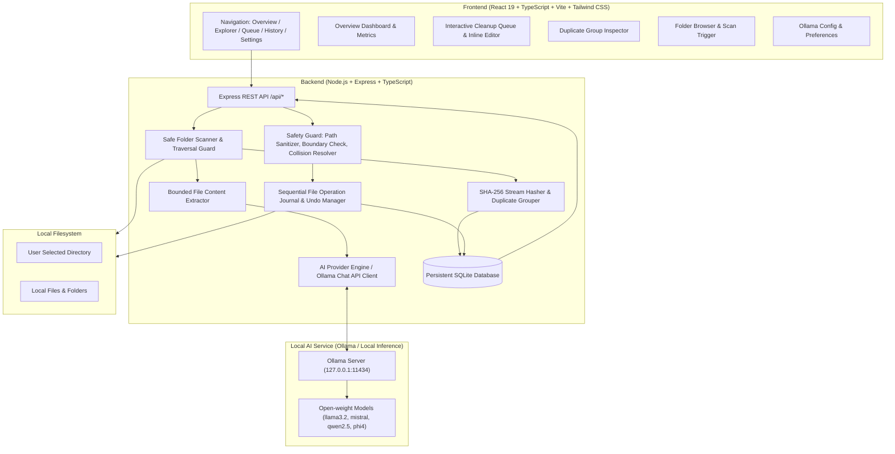

# LazyDesk AI 📁✨

**A Local-First AI File Organizer — Designed for Privacy, Safety, and Digital Zen.**

*Submitted for the Hacktoberfest 2026 Open-Source AI Challenge — Week 3: “Slow and Steady”.*

[](LICENSE)
[-blue.svg)](#privacy-and-open-innovation)
[](#testing)
[](#privacy-and-open-innovation)

---

## 1. Product Vision

LazyDesk AI helps people who procrastinate on file organization automatically clean up their digital workspace. It scans a user-selected folder, analyzes supported files with a locally running open-weight AI model (Ollama), proposes useful filenames and folder categories, detects exact duplicates, and lets the user safely preview, apply, or undo approved changes.

**Core Philosophy:** *The user should spend less time managing files and more time doing meaningful work.*

This is a real, production-ready full-stack application — not a static mockup.

---

## 2. Key Features

- **🛡️ Safe Directory Traversal**: Traverses directories within strict user-selected boundaries. Never escapes workspace boundaries, never follows escaping symbolic links, skips hidden files/directories (`.git`, `node_modules`, `dist`), and strictly blocks scanning protected filesystem roots (`/`, `C:\`, `/System`).
- **🤖 100% Local AI Classification (Ollama)**: Uses local open-weight models (`llama3.2`, `mistral`, `qwen2.5`) through Ollama's Chat API with JSON mode. Document content is treated as untrusted data with strict prompt-injection defenses.
- **🔄 Graceful Offline Fallback**: If Ollama is offline or not installed, the application remains 100% operational using its deterministic rule-based taxonomy engine. Scanning, hashing, duplicate detection, and organization never break.
- **🔍 Exact SHA-256 Duplicate Detection**: Clusters byte-for-byte identical files regardless of file names. Duplicates are never deleted automatically; users inspect copies and confirm safe relocation to `.lazydesk_trash/` or deletion.
- **📋 Interactive Cleanup Queue & Inline Editing**: Review proposed filenames, target categories, confidence scores, and reasoning. Edit proposed names or destination subfolders with instant collision detection.
- **⏪ Recoverable Operation Journal & 100% Undo**: Every single file relocation is recorded in an atomic SQLite ledger. Revert any applied change with a single click.
- **🎨 Minimalist Desktop-First Dashboard**: Neutral charcoal surfaces, restrained emerald green accents, clean typography, dark theme by default with light theme toggle, empty states, and micro-interactions.
- **⚡ Realistic Demo Mode**: 1-click interactive demo mode pre-loaded with realistic unorganized files (receipts, messy code notes, duplicate photos) for instant hands-on testing.

---

## 3. Architecture



---

## 4. Technology Stack

- **Frontend**: React 19, TypeScript, Vite, Tailwind CSS, Lucide icons, clsx.
- **Backend**: Node.js (v20+ / v22+ / v25+), Express, TypeScript, Zod, Better-SQLite3, dotenv, cors.
- **AI**: Ollama running locally via loopback (`127.0.0.1:11434`), structured JSON schema responses, Zod output validation.
- **Testing**: Vitest, React Testing Library, Supertest.

---

## 5. Quick Start & Setup

### Prerequisites

- **Node.js**: v20 or later
- **Ollama** (optional, for local LLM inference): [ollama.ai](https://ollama.ai)

### 1. Installation

```bash
# Clone the repository
git clone https://github.com/your-username/lazydesk-ai.git
cd lazydesk-ai

# Install all monorepo dependencies
npm install

# Build packages
npm run build
```

### 2. Configure Environment

Copy the example configuration:
```bash
cp .env.example .env
```

Default settings in `.env`:
```ini
PORT=3001
HOST=127.0.0.1
OLLAMA_BASE_URL=http://127.0.0.1:11434
OLLAMA_DEFAULT_MODEL=llama3.2
MAX_FILE_SIZE_MB=50
MAX_CONTENT_SAMPLE_CHARS=3000
CONFIDENCE_THRESHOLD=0.75
DATABASE_PATH=./lazydesk.sqlite
```

### 3. Start Development Mode

```bash
# Concurrently starts backend API (:3001) and frontend Vite server (:5173)
npm run dev
```

Open your browser to: **`http://localhost:5173`**

### 4. Running Production Mode

```bash
# Build both frontend and backend
npm run build

# Start production server (serves API and compiled client from loopback :3001)
npm start
```
Open **`http://127.0.0.1:3001`**

---

## 6. Setting Up Local Ollama AI

LazyDesk AI connects to your local Ollama daemon via standard loopback:

1. **Install Ollama**:
   - **macOS**: `brew install ollama`
   - **Linux**: `curl -fsSL https://ollama.com/install.sh | sh`
   - **Windows**: Download installer from [ollama.ai/download](https://ollama.ai/download)

2. **Start the Ollama daemon**:
   ```bash
   ollama serve
   ```

3. **Pull an open-weight model**:
   ```bash
   ollama pull llama3.2
   ```
   *(Or any other model: `ollama pull mistral`, `ollama pull qwen2.5`)*

4. Open LazyDesk AI **Settings** view and click **"Test Ollama Connection"** to verify latency and model availability.

---

## 7. Safety & File Operation Guarantees

File operations carry intrinsic risk. LazyDesk AI enforces multiple defensive layers:

1. **Loopback Binding**: The backend is bound strictly to `127.0.0.1` by default. It never exposes arbitrary filesystem access to external network interfaces.
2. **Boundary Enforcement (`path.resolve`)**: Target destinations are strictly validated against the workspace root. Traversal attacks (`../../etc/passwd`) are rejected.
3. **Filename Sanitization**: Removes null bytes, control codes, illegal path characters (`:`, `*`, `?`, `"`, `<`, `>`, `|`), and Windows reserved device names (`CON`, `PRN`, `AUX`, `NUL`, etc.).
4. **Collision Pre-Validation**: Before executing any file relocation, LazyDesk AI verifies that the destination does not already exist on disk and that multiple operations in the same batch do not target identical paths.
5. **No Silent Overwrites**: The engine will never overwrite an existing file silently.
6. **No Raw Binary to LLMs**: Content extractors verify MIME types and inspect bytes to prevent binary data from being sent to language models.
7. **Prompt-Injection Defense**: User file content is treated as untrusted data, enclosed in `<untrusted_document_content>` tags, and the system prompt instructs the model to ignore instructions contained within the document.
8. **Sequential Journaling & Rollback**: Every file operation is recorded in SQLite. Users can undo operations to restore files to their exact original location.

---

## 8. REST API Documentation

All routes accept and return JSON. Inputs are validated with strict Zod schemas.

| Method | Endpoint | Description |
| :--- | :--- | :--- |
| `GET` | `/api/health` | Health check & service metadata |
| `GET` | `/api/ai/status` | Ollama connectivity, model list, setup steps |
| `GET` | `/api/ai/models` | List locally installed Ollama models |
| `POST` | `/api/ai/test` | Test connection to local Ollama server |
| `POST` | `/api/scan` | Scan a directory (`folderPath`, `skipHiddenFiles`, etc.) |
| `GET` | `/api/scans` | Retrieve scan history records |
| `GET` | `/api/scans/:id` | Retrieve specific scan details, files, and duplicates |
| `POST` | `/api/organize/analyze` | Run AI analysis on scanned files |
| `GET` | `/api/organize/suggestions` | Retrieve AI organization suggestions |
| `PATCH` | `/api/organize/suggestions/:id` | Update proposed name, folder, or status |
| `POST` | `/api/organize/apply` | Apply approved file operations |
| `POST` | `/api/organize/undo` | Revert a completed file operation from journal |
| `GET` | `/api/duplicates` | Retrieve SHA-256 duplicate clusters |
| `POST` | `/api/duplicates/delete` | Safely move duplicates to `.lazydesk_trash` or delete |
| `GET` | `/api/settings` | Get application configuration |
| `PATCH` | `/api/settings` | Update configuration with Zod validation |
| `GET` | `/api/browse?dir=...` | Browse local directories & quick bookmarks |
| `POST` | `/api/demo/seed-files` | Generate realistic messy files in `test-data/` |
| `POST` | `/api/demo/seed-db` | Seed realistic demo scan data |

---

## 9. Privacy and Open Innovation

LazyDesk AI was engineered to demonstrate the real-world advantages of local-first AI:

1. **Zero Data Leakage**: File contents, filenames, and prompts remain exclusively on your computer. Nothing is uploaded to cloud servers or third-party APIs.
2. **Offline Resilience**: Once your model weights (`llama3.2`) are pulled, LazyDesk AI works completely offline on trains, airplanes, and air-gapped workstations.
3. **Open-Weight vs. Open-Source Transparency**: We clearly distinguish between open-source code and open-weight model weights:
   - LazyDesk AI source code is licensed under **MIT**.
   - Model weights carry their respective licenses (e.g., *Meta Llama 3 Community License*, *Apache 2.0* for Mistral/Qwen).
   - LazyDesk AI gives you total freedom to switch or substitute any local model without lock-in.

---

## 10. Automated Testing

The automated test suite verifies all safety invariants, parsers, and APIs:

```bash
npm test
```

### Test Coverage Highlights:
- ✅ **Boundary Enforcement**: Validates that paths outside workspace and root traversal attacks (`/`, `/etc/passwd`) are rejected.
- ✅ **Symbolic Link Guards**: Ensures symlinks outside workspace boundaries are never followed.
- ✅ **Filename Sanitizer**: Verifies stripping of null bytes, control codes, and Windows reserved device names (`CON.txt`, `PRN`).
- ✅ **SHA-256 Hasher**: Verifies byte-level exact duplicate grouping.
- ✅ **Malformed AI Recovery**: Tests rejection of invalid AI JSON responses and verifies fallback mechanisms.
- ✅ **Destination Collisions**: Detects batch destination conflicts and pre-existing files before execution.
- ✅ **Apply & Rollback**: Verifies sequential file moves, journal creation, and 100% undo capability.
- ✅ **REST API Supertest**: End-to-end integration tests covering all routes and error scenarios.

---

## 11. Troubleshooting

| Issue | Resolution |
| :--- | :--- |
| **"Ollama offline / Rule Fallback"** | Ensure Ollama is running in your terminal: `ollama serve`. In Settings, click "Test Ollama Connection". If Ollama is not installed, LazyDesk AI continues functioning normally using its rule-based categorizer. |
| **"Destination file already exists"** | LazyDesk AI prevents accidental overwrites. Click the edit icon in the Cleanup Queue to rename the proposed destination. |
| **"Refusing to scan protected root"** | Root filesystem paths like `/` or `C:\` are protected. Choose a specific subfolder (e.g. `Downloads`, `Documents`, or `test-data`). |
| **"File no longer exists for rollback"** | If a file was manually moved or deleted externally after being organized, rollback reports a clear error to prevent corruption. |

---

## 12. License

Distributed under the **MIT License**. See [`LICENSE`](LICENSE) for details.
